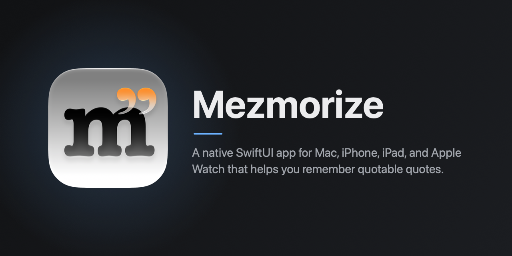

# Mezmorize

Mezmorize helps you memorize quotable quotes with the Three-minute Memory Method.
It's a native app for macOS, iOS, and iPadOS, with a review-only Apple Watch companion.

## Get started

- [Website](https://dan-snelson.github.io/mezmorize-app/) — what Mezmorize does, features, and screenshots
- [Join the beta on TestFlight](https://dan-snelson.github.io/mezmorize-app/testflight.html) — try it early
- [Quotes](https://dan-snelson.github.io/mezmorize-app/quotes.html) — import quotes from the web or download ready-made collections
- [Support](https://dan-snelson.github.io/mezmorize-app/support.html) — help and contact
- [Privacy](https://dan-snelson.github.io/mezmorize-app/privacy.html) — what happens to your data

## Community and help

- [Wiki](https://github.com/dan-snelson/mezmorize-app/wiki) — how-to guides for using the app
- [Discussions](https://github.com/dan-snelson/mezmorize-app/discussions) — questions, ideas, quote sharing, and TestFlight feedback
- [Report a bug](https://github.com/dan-snelson/mezmorize-app/issues/new/choose)

## About this repository

This repository holds the public web site only; the app's source code isn't here.
See [LICENSE](LICENSE).
